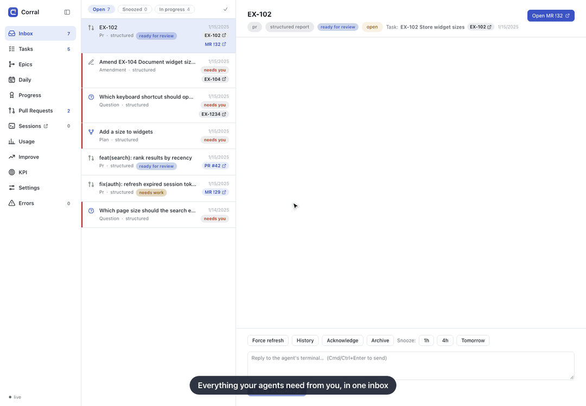

# Corral

**Delegate the work. Keep the decisions.**

Corral gives developers using coding agents one inbox for questions, approvals,
and pull requests. Send a task to Claude Code, Codex, or OpenCode; come back when
there is something to decide or review.



## From a task to a reviewed change

Running several agents creates work of its own: following sessions, answering
questions, tracking tickets, and checking whether a PR is ready. Corral brings
those handoffs together so you can follow the work across repositories.

1. **Capture the work.** Create a task or import a Jira ticket. Choose its repo
   and coding harness; model and agent settings are optional.
2. **Dispatch.** The agent works in an isolated git worktree managed by
   omnigent. Questions and permission requests arrive in your inbox.
3. **Review the result.** Corral checks PR threads, checks, and mergeability.
   Review comments and conflicts go back to the agent; you review and merge.
4. **Close the loop.** A merged PR completes the task and archives its inbox
   items. Task history keeps the prompts, questions, and milestones accessible.

For larger changes, Jira epics organize dependencies and versioned designs.
Tasks become available as their blockers clear and wait for you to launch them.
GitHub and GitLab PRs also have a shared listing, including review requests.
See the [product guide](docs/product-guide.md) for the full workflow.

## Built around human review

- **An inbox for decisions:** structured questions, plan approvals, snoozing,
  and links to the underlying agent sessions.
- **A visible readiness gate:** a fresh PR stays orange until automated reviews
  pass. Green requires answered or resolved threads, passing checks, and a
  mergeable branch. Human approval remains a separate step.
- **Work across repositories:** per-task worktrees, multi-repo specification
  tasks, and Jira epic dependencies keep related changes traceable.
- **Local context:** SQLite stores work and history; usage views read local
  session data. Agent backends and connected platforms still make network calls.

Corral owns work coordination. **omnigent owns agent execution**, sessions,
worktrees, and model routing. Corral links out to inspect those sessions rather
than embedding a terminal or transcript viewer.

## Quickstart

Requires **Node.js 22.18 or newer** and npm. To dispatch tasks, you also need a
running **omnigent** server with the coding harnesses you want to use. PR features
use authenticated `gh` (GitHub) or `glab` (GitLab) CLIs; Jira integration is optional.

```sh
git clone https://github.com/fabienfleureau/corral.git
cd corral
npm ci
npm run build
npm run serve
```

Open the access URL printed by the server, usually
`http://127.0.0.1:4787/?token=…`. It establishes the browser cookie and removes
the token from the URL. Configure the omnigent connection and repository roots
in Settings or `~/.config/corral/config.json`; restart the server after config
file edits. Match its backend URL, token, and host registration to your omnigent
installation. The default backend URL is `http://127.0.0.1:6767`.

See the [configuration and CLI guide](docs/product-guide.md#configuration) for
connection keys, model settings, and environment overrides.

## Engineering tour

The server runs TypeScript directly on Node 22 with built-in HTTP and SQLite
modules and **no server runtime dependencies**. The UI uses React, Vite, and
plain CSS. The backend is a single process with explicit integration boundaries.

| Start here | What to inspect |
|---|---|
| [Architecture](docs/architecture.md) | System diagram, dispatch-to-review flow, ownership, trade-offs and limits |
| [Decision records](docs/adr/README.md) | Product decisions and the ADR policy applied to future changes |
| [Worker interface](server/worker.ts) | The boundary between work coordination and agent execution |
| [API contract](API.md) | HTTP endpoints and payloads |
| [Prompt registry](docs/prompts.md) | What Corral tells agents, when, and where each prompt lives |
| [Glossary](GLOSSARY.md) | Epic and design vocabulary |
| [Contributing](CONTRIBUTING.md) | Setup, verification and review expectations |

```sh
npm test
npm run typecheck
npm run build
npm run check:adr
```

Tests use temporary databases and fake integrations. The repository also includes
an isolated fixture for repeatable UI captures; see [AGENTS.md](AGENTS.md#repeatable-ui-screenshots).

## Current scope

Corral is a personal, locally hosted application under active development.
Authentication uses a shared token, with no user roles or tenant isolation.
It is not ready to expose as a public or multi-user service. Keep access URLs
and configuration credentials private; the browser may cache work data offline.

The [roadmap](docs/product-guide.md#roadmap) separates planned work from shipped
features. Every source change goes through a PR; the human reviews and merges.
