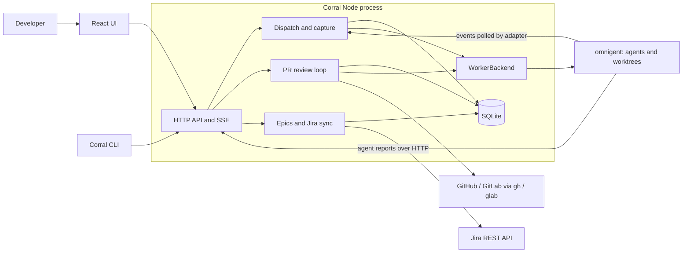

# Architecture

[Product](../README.md) · [Decision records](adr/README.md) · [API contract](../API.md)

Corral is the work layer: tasks, questions, approvals, and PR readiness.
omnigent is the agent layer: sessions, harnesses, worktrees, and model routing.
This is a single-process local application, not a distributed job platform.

## System context

SSE carries update notifications back to the browser; the UI reads current state
through the API. The diagram groups responsibilities, not separate services.

## Responsibilities and integration boundaries

| Area | Code and responsibility |
|---|---|
| Composition | [`server/index.ts`](../server/index.ts) loads config, constructs storage, backend and services, starts HTTP, and schedules refreshes |
| Browser | [`web/src/api.ts`](../web/src/api.ts) is the HTTP/SSE client; [`web/public/sw.js`](../web/public/sw.js) caches the shell and last-known API responses |
| HTTP | [`server/api.ts`](../server/api.ts) authenticates API requests, handles routes and serves `web/dist`; [`API.md`](../API.md) describes the contract |
| Dispatch | [`server/dispatch.ts`](../server/dispatch.ts) assembles prompts and attachments, selects a base and requests an agent session |
| Agent execution | [`server/worker.ts`](../server/worker.ts) defines `WorkerBackend`; [`server/omnigent.ts`](../server/omnigent.ts) implements it, including polling, event normalization and Antigravity's unattended launch args ([ADR 0014](adr/0014-antigravity-permission-bypass.md)) |
| Inbox lifecycle | [`server/capture.ts`](../server/capture.ts) turns backend events and agent reports into actionable items, runs bounded automatic retries for stopped sessions ([`server/stopped-retry.ts`](../server/stopped-retry.ts), [ADR 0016](adr/0016-stopped-agent-retry-policy.md)) and handles completion/fallbacks |
| PR lifecycle | [`server/pr.ts`](../server/pr.ts) discovers and refreshes task PRs, computes readiness, classifies observe-only risk triage ([`server/pr-triage.ts`](../server/pr-triage.ts), [ADR 0019](adr/0019-pr-risk-triage-observe-only.md)), and returns comments, conflicts and failing CI checks to agents |
| Platform listing | [`server/pulls.ts`](../server/pulls.ts) lists GitHub/GitLab PRs; [`server/repos.ts`](../server/repos.ts) handles git repositories; subprocesses use [`server/exec.ts`](../server/exec.ts) |
| Jira and epics | [`server/jira.ts`](../server/jira.ts) handles Jira HTTP; [`server/jira-status.ts`](../server/jira-status.ts) advances lifecycle stages; [`server/epic.ts`](../server/epic.ts) syncs epic metadata, Jira child tickets (`epic_tickets`) and dependency links without creating Corral tasks ([ADR 0018](adr/0018-epic-agent-creates-tasks.md)); [`server/epic-orchestration.ts`](../server/epic-orchestration.ts) coordinates epic launch; [`server/epic-agent.ts`](../server/epic-agent.ts) runs opted-in autonomous epic implementation cycles with workspace memory in `.corral/epic-<key>-memory.md` ([ADR 0017](adr/0017-epic-autonomous-agent.md)) and operates real Corral tasks (creating, launching/dispatching, instructing, checking PRs and moving statuses) via Corral's HTTP API ([ADR 0020](adr/0020-epic-agent-operates-corral-tasks.md)) |
| Persistence | [`server/db.ts`](../server/db.ts) owns schema, migrations and queries; [`server/task-events.ts`](../server/task-events.ts) records task history |
| Agent instructions | [`skills/`](../skills) holds injected conventions; [`docs/prompts.md`](prompts.md) registers file-based and inline prompts |
| KPI monitoring | [`server/kpi.ts`](../server/kpi.ts) schedules opted-in, independent KPI analysis cycles, collects typed evidence from worker outcomes, keeps a bounded report memory, the measurement history and an optional goal baseline in SQLite and a per-KPI note in the working directory ([ADR 0005](adr/0005-kpi-scheduling-and-memory.md), [ADR 0008](adr/0008-kpi-memory-file.md)); a cycle's agent comes from a configured favorite and an arbitrary working directory ([ADR 0007](adr/0007-kpi-favorite-and-working-directory.md)) |
| KPI artifacts | [`server/kpi-artifact.ts`](../server/kpi-artifact.ts) turns saved KPI reports into a private Claude artifact request with the sections chosen on the page; it dispatches an `ops` task so the URL comes back through the inbox ([ADR 0013](adr/0013-kpi-status-artifacts.md)) |
| Agent control | [`server/agent-control.ts`](../server/agent-control.ts) exposes three MCP tools (`corral_next`, `corral_create_task`, `corral_instruct`) through `POST /api/mcp`; results are one short line for voice use, and dispatch remains human-owned |
| Worktree cleanup | [`server/worktree-cleanup.ts`](../server/worktree-cleanup.ts) decides when a terminal task no longer needs its worktree and asks `WorkerBackend.cleanup`; an open PR item holds the branch, and a sweep after PR sync retries leftovers ([ADR 0012](adr/0012-terminal-tasks-release-worktrees.md)) |

`WorkerBackend` is an explicit interface that tests can replace with a fake.
Platform modules are integration boundaries, but they are not all interchangeable
adapters behind a common interface. In particular, `api.ts` combines transport
and application orchestration, and `pr.ts` combines provider access and lifecycle
policy. Documenting these limits does not remove their coupling; extract code
when a concrete change needs a narrower responsibility.

## A task from dispatch to review

1. The API stores a task, or imports it from Jira. Dispatch assembles its prompt,
   convention files, optional reviewer command, settings, and attachments.
2. `dispatchTask` asks `WorkerBackend.start` for a session. For a code task,
   omnigent prepares the requested worktree and runs the harness. Review, spec,
   ops, and interview tasks have different completion contracts; they do not all open PRs. Interview rounds are reported as questions and answered together; documentation interviews use a worktree and may produce a PR.
3. Backend events enter `CaptureEngine`. Agents can also submit structured
   reports to `/api/reports`. Questions and permission requests become inbox
   items; a run ending without a report produces a fallback item.
4. A human answer travels through the backend to the agent. State changes are
   persisted and broadcast through the SSE hub.
5. A reported or discovered PR enters the refresh loop. Reviews and conflicts
   are sent to the agent for another turn. Refreshing a task does not mean it
   is ready: `prReady` evaluates its current checks, threads and mergeability.
6. A fresh PR stays orange until automated reviews pass. Green means ready for
   human review. Human approval determines the separate ready-to-merge label.
   Merging completes the task and archives its items; Corral does not merge it.
7. A done or archived task with no open PR item asks the backend to remove its
   worktree and local branch. The sweep after PR sync retries leftovers and
   failed removals.

Polling runs in this process: the PR loop is scheduled every two minutes and
pull listings every three minutes in `index.ts`. Provider rate limits, failures,
agent connectivity and application uptime therefore affect freshness. Stored
snapshots are not a guarantee that an external platform has not changed.

## Data ownership and persistence

SQLite holds tasks, inbox items, repository registrations, task events, metrics,
and epic execution/design history. Its default path is
`~/.local/share/corral/corral.db`; configuration lives separately in
`~/.config/corral/config.json`. See [`server/config.ts`](../server/config.ts).

Schema evolution uses additive migrations in `Db.migrate()`. Existing database
files must remain readable when a version adds fields. Task events form an
append-only history; this is not an event-sourced system that reconstructs every
piece of state from an event log. Local SQLite keeps deployment small, but the
synchronous database API and background work share the Node process.

Jira owns epic tickets and dependency links. Corral owns execution and design
history; validated design/amendment updates replace only Corral's delimited
blocks in Jira descriptions. Status transitions move forward. See
[ADR 0001](adr/0001-jira-source-of-truth-for-epics.md).
An unblocked epic task waits for explicit launch, per
[ADR 0002](adr/0002-epic-tasks-start-from-epic-page.md).

## Trust and operational limits

The default listener is `127.0.0.1:4787`. API access uses a shared bearer token,
query token or browser cookie, except for the health endpoint. The initial
access URL sets an `HttpOnly`, `SameSite=Strict` cookie and redirects to remove
the token. This is local access control, not user identity, roles or tenant
isolation; the server provides HTTP rather than a public HTTPS deployment.

The MCP route uses that same token: it narrows what a voice agent sees, not
the credential's reach. Per [ADR 0004](adr/0004-agent-control-mcp.md), its tools
never dispatch a task or answer an inbox item.

Agents, platform CLIs, and Jira use the privileges of configured accounts.
Ticket and review text is untrusted input, including when passed to an agent;
[`server/test/untrusted-data.test.ts`](../server/test/untrusted-data.test.ts)
checks the prompt boundary. Local storage and offline browser caches can hold
work content. Do not use a live account or real data for demo captures.

There is no durable external queue or multi-process scheduler. A restart
interrupts in-process work, and config file changes require a restart. Server
changes also require a restart; a web build is served on the next request.
These constraints define the current personal deployment scope.

## Evidence and future changes

[`server/test/core.test.ts`](../server/test/core.test.ts) exercises dispatch,
readiness and capture using temporary databases and a fake backend.
Dedicated suites cover epic launch, Jira block ownership, PR refresh, and
untrusted data. [`AGENTS.md`](../AGENTS.md#repeatable-ui-screenshots) describes
the isolated screenshot fixture. Automated checks do not replace a live
integration smoke test when changing a provider boundary.

For a consequential new boundary or technology choice, write an
[ADR](adr/README.md) in the same PR and update this page if the architecture
changes. Record alternatives and consequences from that actual decision;
existing implementation details here are not reconstructed historical ADRs.
